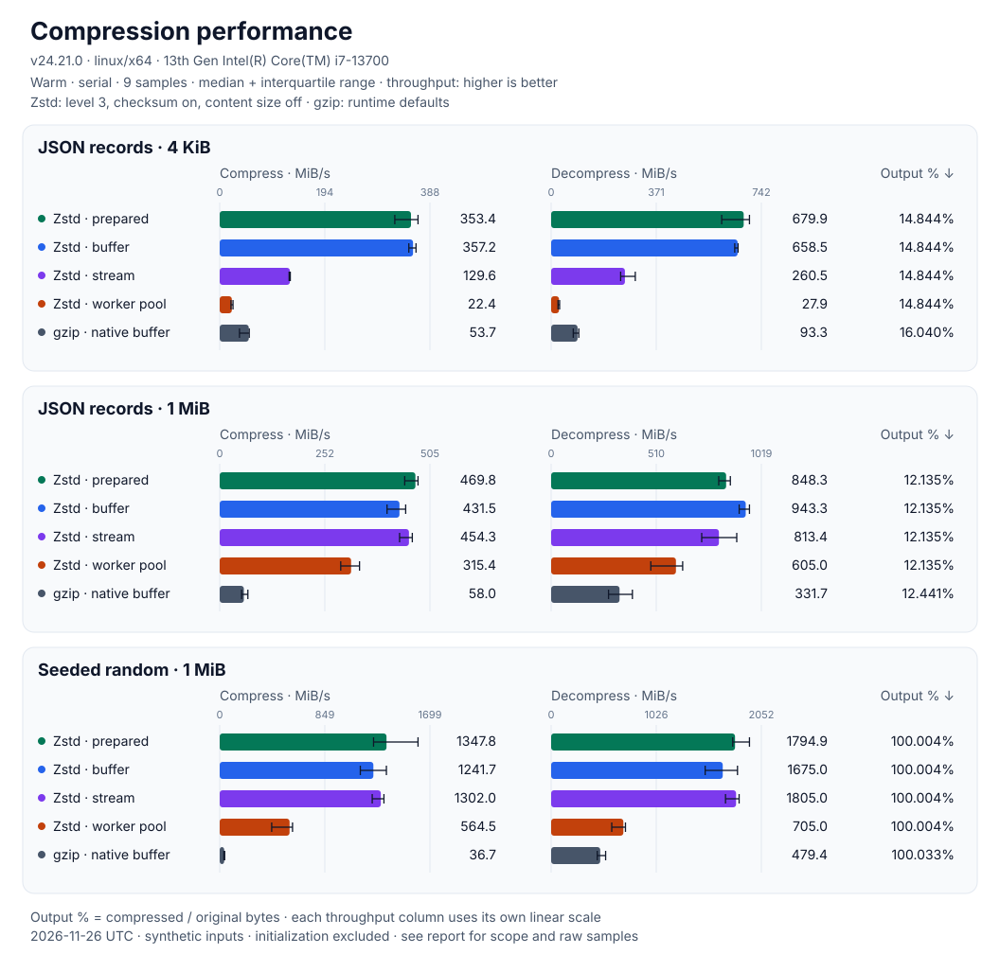

# Compression

Zstandard (WASM) plus native `gzip`, `deflate`, and `deflate-raw` for browsers, Web Workers, and Node.js 24+. Provides buffer and Web Streams APIs with backpressure, byte limits, `AbortSignal`, and optional worker offloading. Zero runtime dependencies.

```sh
npm install @works42/compression
```

## Quick Start

### Buffers

```js
import { compress, decompress } from '@works42/compression'

const input = new TextEncoder().encode('Hello, Zstandard!')
const compressed = await compress(input, { format: 'zstd' })
const restored = await decompress(compressed, { format: 'zstd' })
```

Accepts `ArrayBuffer`, `Uint8Array`, `DataView`, and Node `Buffer`. Returned `Uint8Array` instances own their backing bytes. For repeated synchronous calls with fixed settings, use [`createZstdCodec`](docs/api.md#prepared-zstd-codec).

### Streams

```js
import { createCompressionStream } from '@works42/compression'

const compressor = await createCompressionStream({ format: 'zstd', signal })
await source.pipeThrough(compressor).pipeTo(destination, { signal })
```

Use `createDecompressionStream` to decompress. If you already have a `ReadableStream`, `compressStream(source, options)` and `decompressStream(source, options)` return the transformed `ReadableStream` directly.

Set `maxInputBytes` or `maxOutputBytes` to bound stream sizes.

## Formats & Workers

- **`zstd`**: Bundled WASM; supports `level`, `checksum`, `contentSize`, `dictionary`, and `maxWindowLog`.
- **`gzip`, `deflate`, `deflate-raw`**: Uses the runtime's native compression stream APIs.
- **Workers**: Pass `execution: 'worker'` to offload work, and [`createWorkerPool`](docs/api.md#worker-pool) to reuse workers across calls. Browser worker mode requires transferable Web Streams.
- **TypeScript**: Requires TypeScript 5.7+ with the `DOM` lib enabled.

See [docs/api.md](docs/api.md) for all options and [CHANGELOG.md](CHANGELOG.md) for release notes.

## Performance



Measured on Node.js 24 (warmed serial calls, Zstd level 3 vs native `gzip`). See the [benchmark report](docs/performance/README.md) for tables, environment details, and reproduction steps.

## Examples

From a source checkout, build first (`npm ci && make toolchain && npm run build`):

- [Browser file demo](examples/browser-file.html) — serve locally with `python3 -m http.server 8000 --bind 127.0.0.1`
- [Node file streaming](examples/node-stream.mjs) — `node examples/node-stream.mjs compress input.txt input.txt.zst`
- [Node worker pool](examples/node-worker-pool.mjs) — `node examples/node-worker-pool.mjs first.txt second.txt`
- [Reusable sync codec](examples/prepared-codec.mjs) — `node examples/prepared-codec.mjs`

## Development

Requires Node.js 24+, npm, Docker, and Make:

```sh
npm ci
make toolchain
npx playwright install --with-deps chromium firefox webkit
npm run release:check
```

## License

Project code is [MIT](LICENSE); bundled Zstandard is [BSD 3-Clause](LICENSE.zstd).
