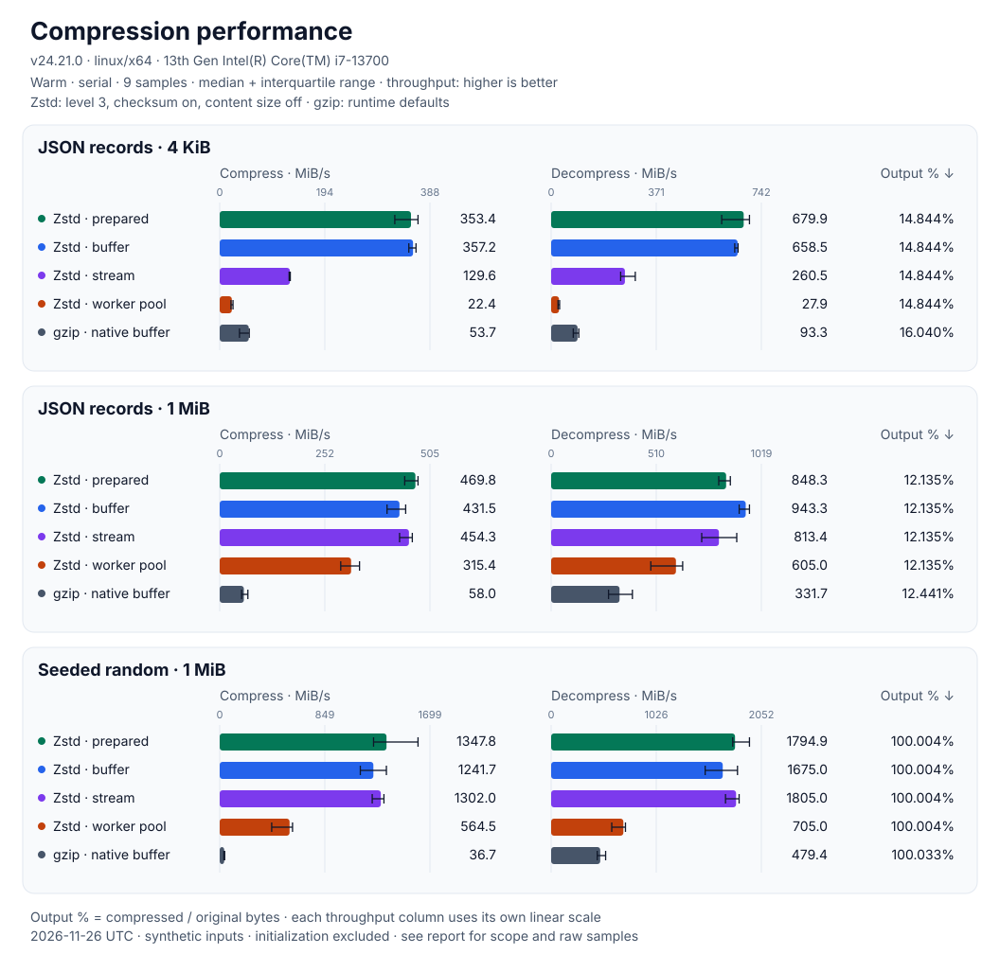

# Performance Report

Generated by [benchmark.mjs](../../tools/benchmark.mjs) and [render-benchmark.mjs](../../tools/render-benchmark.mjs).
Charts, tables, and [results.json](results.json) come from the same run; do not hand-edit generated numbers.



## Environment

| Item                       | Value                                                      |
| -------------------------- | ---------------------------------------------------------- |
| Timestamp                  | Nov 26, 2026, 7:14 AM UTC                                  |
| Package                    | @works42/compression 0.1.0                                 |
| Node.js / V8               | v24.21.0 / 13.6.233.17-node.53                             |
| OS                         | linux 7.0.0-44-generic / x64                               |
| CPU                        | 13th Gen Intel(R) Core(TM) i7-13700                        |
| Logical CPUs / Parallelism | 24 / 24                                                    |
| Zstd / WASM                | 1.6.0                                                      |
| Scheduling                 | Serial single-task; Worker pool size 1                     |
| Zstd settings              | level 3, checksum: true, contentSize: false; no dictionary |
| gzip settings              | Runtime native compression API defaults                    |

SHA-256 digests of sources and build artifacts are recorded under `sources` and `artifacts` in `results.json`;
input digests are recorded under `corpora`.

## Reproduce

With Node.js 24+, npm, Docker, and Make:

```sh
npm ci
make toolchain
npm run bench
```

Use `npm run bench:render` to regenerate charts and Markdown from `results.json`. Tune sampling with `BENCH_SAMPLES` (3–100, default 9) and `BENCH_SAMPLE_MS` (10–10000, default 100):

```sh
BENCH_SAMPLES=3 BENCH_SAMPLE_MS=10 npm run bench -- .local/benchmark-smoke
```

## Methodology

- **Inputs**: Seeded 4 KiB and 1 MiB JSON record arrays plus 1 MiB pseudorandom bytes.
- **Verification**: Round-trip and Node native Zstd cross-checks run before and after sampling.
- **Sampling**: Warmup loop followed by 9 rounds (~100 ms per batch), rotating corpus, method, and direction. Bars show median throughput; whiskers show the 25th–75th percentiles.
- **Units**: Throughput uses original uncompressed bytes (1 MiB = 1,048,576 B) over full warmed API calls (excluding input generation and init). `Output %` is compressed / original bytes.
- **Methods**: `prepared` uses `createZstdCodec()`, `buffer` uses `compress()`/`decompress()`, `stream` uses 64 KiB chunks, `worker` uses a warmed pool of size 1 (no `transferInput`), and `gzip` uses this library's native adapter.
- **Scope**: Node.js serial execution only; browser performance, cold startup, and memory usage are not measured.

## Results

Higher throughput is better; lower latency and output % are better. ms/op is in milliseconds.

### JSON records · 4 KiB

| Method               | Compress MiB/s | Decompress MiB/s | Compress ms/op | Decompress ms/op | Compressed Bytes | Output % |
| -------------------- | -------------: | ---------------: | -------------: | ---------------: | ---------------: | -------: |
| Zstd · prepared      |          353.4 |            679.9 |          0.011 |            0.006 |              608 |  14.844% |
| Zstd · buffer        |          357.2 |            658.5 |          0.011 |            0.006 |              608 |  14.844% |
| Zstd · stream        |          129.6 |            260.5 |          0.030 |            0.015 |              608 |  14.844% |
| Zstd · worker pool   |           22.4 |             27.9 |          0.174 |            0.140 |              608 |  14.844% |
| gzip · native buffer |           53.7 |             93.3 |          0.073 |            0.042 |              657 |  16.040% |

### JSON records · 1 MiB

| Method               | Compress MiB/s | Decompress MiB/s | Compress ms/op | Decompress ms/op | Compressed Bytes | Output % |
| -------------------- | -------------: | ---------------: | -------------: | ---------------: | ---------------: | -------: |
| Zstd · prepared      |          469.8 |            848.3 |          2.129 |            1.179 |           127244 |  12.135% |
| Zstd · buffer        |          431.5 |            943.3 |          2.317 |            1.060 |           127244 |  12.135% |
| Zstd · stream        |          454.3 |            813.4 |          2.201 |            1.229 |           127244 |  12.135% |
| Zstd · worker pool   |          315.4 |            605.0 |          3.171 |            1.653 |           127244 |  12.135% |
| gzip · native buffer |           58.0 |            331.7 |         17.240 |            3.015 |           130455 |  12.441% |

### Seeded random · 1 MiB

| Method               | Compress MiB/s | Decompress MiB/s | Compress ms/op | Decompress ms/op | Compressed Bytes | Output % |
| -------------------- | -------------: | ---------------: | -------------: | ---------------: | ---------------: | -------: |
| Zstd · prepared      |         1347.8 |           1794.9 |          0.742 |            0.557 |          1048613 | 100.004% |
| Zstd · buffer        |         1241.7 |           1675.0 |          0.805 |            0.597 |          1048613 | 100.004% |
| Zstd · stream        |         1302.0 |           1805.0 |          0.768 |            0.554 |          1048613 | 100.004% |
| Zstd · worker pool   |          564.5 |            705.0 |          1.771 |            1.418 |          1048613 | 100.004% |
| gzip · native buffer |           36.7 |            479.4 |         27.262 |            2.086 |          1048919 | 100.033% |
